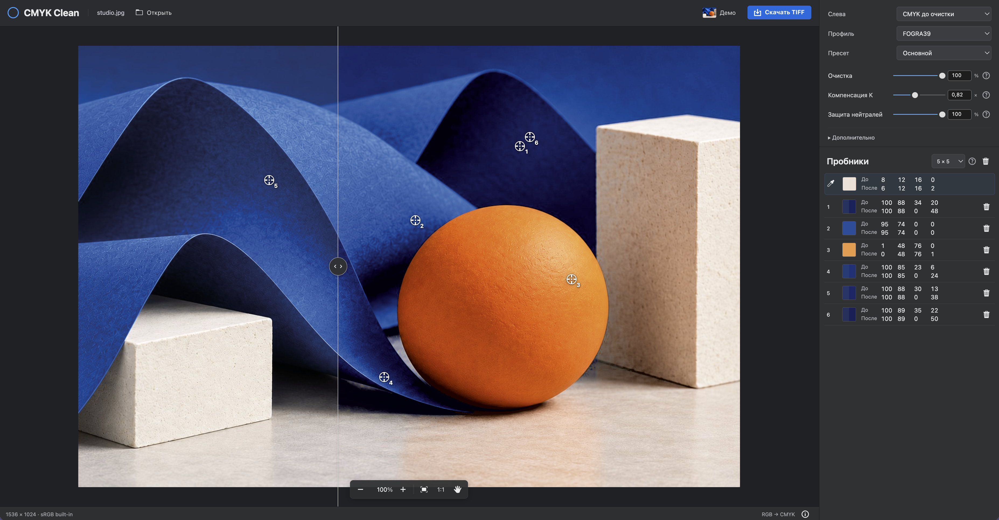

# RGB2CMYK Cleaner

[Русский](README.md) · [English](README.en.md) · [简体中文](README.zh-CN.md)

**The easiest way to install it is to ask your AI agent.** Copy this request:

> Install and run RGB2CMYK Cleaner from https://github.com/Nicomashi/rgb2cmyk-cleaner on my computer. Detect my operating system, follow the repository's installation guide, install dependencies with uv, and help me add a CMYK ICC profile. Check that the demo opens and TIFF export works, then give me the application URL.

For **Windows, Linux, and macOS**. [Manual installation guide](docs/installation.en.md).

Quickly prepare AI-generated artwork for print with cleaner colors, without complex manual color correction.

Best suited to illustrations, posters, and graphics with solid fills. Less suitable for photos of people: cleanup can noticeably alter skin tones.

## How it works

The app converts an image to CMYK using a print ICC profile, reduces unwanted color ink, and compensates with black. Adjust cleanup strength and black compensation while comparing the result with the original.

1. Open an image, or click **Demo** to try it out.
2. Adjust **Cleanup** and **K compensation**. Drag the divider to compare before and after.
3. Click **Download TIFF** to get a CMYK file at the original resolution with an embedded ICC profile.

A reduced preview keeps editing responsive; export uses the original image. The screen preview helps you choose settings; make a test print before a production run.

## Installation and startup

Choose your system: [Windows](docs/installation.en.md#windows), [Linux](docs/installation.en.md#linux), or [macOS](docs/installation.en.md#macos).

On all three systems, the app runs locally and opens in your browser at **http://127.0.0.1:8765**. The interface is already built; Node.js is not required.

## Controls

- **Mouse wheel** — zoom; **Space + drag** — pan the image.
- **Hover** — read CMYK values under the cursor.
- **Shift + click** — pin a sampler; its values update as you change settings.
- **Alt / Option** — display values next to the samplers on the image.
- **Left view** — switch between CMYK before cleanup and the original image.

## Languages

The interface supports **Russian, English, and Simplified Chinese (简体中文)**. Use the language selector at the top, next to **Demo**. Your browser remembers the selection; switching languages does not reload the page or remove samplers.

## Formats and saving

Supports single-page, 8-bit PNG, JPEG, and TIFF images. CMYK input requires an embedded ICC profile; RGB without a profile is treated as sRGB. Transparency is flattened onto white. PDF, 16-bit images, and layers are not supported yet.

Download your result before closing or reloading the page. Opening a new file or reloading clears the working session; your original and downloaded files remain yours. Use one tab: opening another resets the current session.

## Development

[Building the interface and running tests](docs/development.en.md). The interface uses Adobe Spectrum Web Components; dependency licenses are listed in [THIRD_PARTY_NOTICES.txt](THIRD_PARTY_NOTICES.txt).
